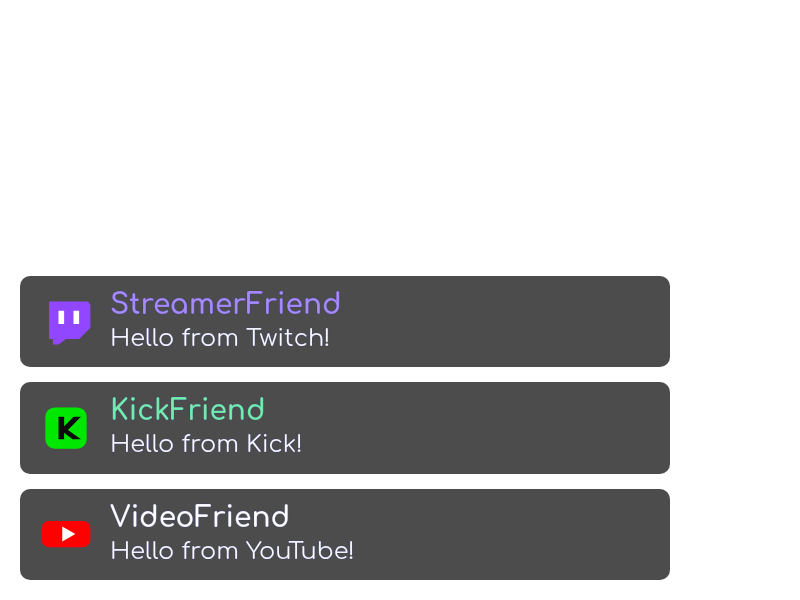
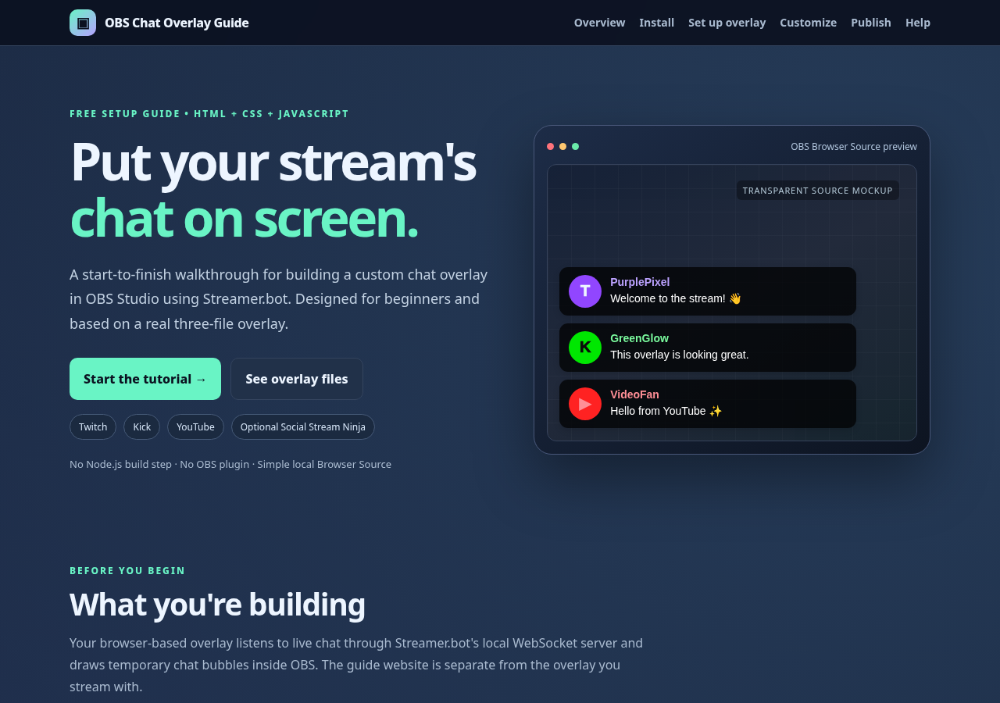

[README(4).md](https://github.com/user-attachments/files/33882017/README.4.md)

[README(3).md](https://github.com/user-attachments/files/33879530/README.3.md)<h1 align="center">💬 OBS + Streamer.bot Chat Overlay</h1>

<p align="center">
  <strong>A customizable, animated chat overlay for OBS Studio.</strong><br>
  Display Twitch, Kick, and YouTube messages together with Streamer.bot - using just HTML, CSS, and JavaScript.
</p>

<p align="center">
  <a href="#-quick-start">Quick Start</a> ·
  <a href="#-complete-setup-guide">Full Setup</a> ·
  <a href="#-twitch-profile-pictures-optional">Twitch Avatars</a> ·
  <a href="#-customization">Customize</a> ·
  <a href="#-troubleshooting">Troubleshooting</a> ·
  <a href="docs/index.html">Visual Website Guide</a>
</p>

<p align="center">
  
</p>

<p align="center"><sub>Demo messages from the included overlay. The white background is only for the preview image; the actual OBS Browser Source is transparent.</sub></p>

---

## ✨ Features

- **Multiplatform chat:** Twitch, Kick, and YouTube through Streamer.bot WebSocket events.
- **Animated messages:** a quick bounce-in, a readable pause, and a slide/fade-out to the left.
- **Profile pictures and fallbacks:** platform icons, available profile images, and optional real Twitch avatars via a Streamer.bot C# action.
- **Readable design:** rounded dark message cards, colored usernames, and inline Twitch emotes.
- **One CSS file:** change everything in `overlay/style.css`; no duplicate OBS Custom CSS.
- **Easy testing:** built-in demo mode, so you can preview the overlay before you stream.
- **Optional extras:** Social Stream Ninja can provide additional platform messages.

### Platform support at a glance

| Source | How messages arrive | Setup |
| :--- | :--- | :--- |
| **Twitch** | Streamer.bot `Twitch.ChatMessage` | Connect Twitch; optional C# action for profile pictures |
| **Kick** | Streamer.bot `Kick.ChatMessage` | Connect Kick on a compatible Streamer.bot release |
| **YouTube** | Streamer.bot `YouTube.Message` | Connect YouTube and monitor a live broadcast |
| **TikTok / Instagram / additional YouTube** | Social Stream Ninja WebSocket | **Optional**; disabled by default |
| **Your own events** | Streamer.bot `General.Custom` | Optional advanced integrations |

> [!IMPORTANT]
> **The GitHub Pages website is the tutorial.** In OBS, load your **local `overlay/index.html`** file. The tutorial is at `docs/index.html`.

---

## 📑 Table of contents

1. [Quick start](#-quick-start)
2. [Requirements](#-requirements)
3. [Complete setup guide](#-complete-setup-guide)
   - [01 — Install OBS Studio](#01--install-obs-studio)
   - [02 — Install Streamer.bot](#02--install-streamerbot)
   - [03 — Connect your streaming account](#03--connect-your-streaming-account)
   - [04 — Enable the WebSocket server](#04--enable-the-streamerbot-websocket-server)
   - [05 — Put the overlay on your PC](#05--put-the-overlay-on-your-pc)
   - [06 — Add a Browser Source in OBS](#06--add-a-browser-source-in-obs)
   - [07 — Test without going live](#07--test-without-going-live)
   - [08 — Test real chat](#08--test-real-chat)
4. [Twitch profile pictures (optional)](#-twitch-profile-pictures-optional)
5. [Customization](#-customization)
6. [Social Stream Ninja (optional)](#-social-stream-ninja-optional)
7. [Troubleshooting](#-troubleshooting)
8. [Publish your own GitHub page](#-publish-your-own-github-page)
9. [Project files and credits](#-project-files-and-credits)

---

## ⚡ Quick start

Already have OBS and Streamer.bot? Here's the short version:

1. Download this repository using **Code → Download ZIP** and extract it.
2. Move its **`overlay`** folder somewhere permanent (for example, `C:\OBS-Chat-Overlay\`).
3. In **Streamer.bot → Servers/Clients → WebSocket Server**, start the server with `127.0.0.1`, port `8080`, and endpoint `/`.
4. Connect the streaming platforms you use in Streamer.bot.
5. In **OBS → Sources → + → Browser**, enable **Local file** and select `overlay/index.html`.
6. Set a starting browser size of **800 × 600**. Keep OBS's **Custom CSS** box **empty**.
7. Send a chat message, or enable `DEMO_MODE = true` in `overlay.js` to see example messages.

**No Node.js, OBS plugin, Visual Studio, or custom local web server required.**

> [!TIP]
> If something doesn't work, follow the complete instructions below in order. Start with **demo mode**, then test real chat. These isolate layout issues from connectivity issues.

## 📋 Requirements

| What you need | Why |
| :--- | :--- |
| [OBS Studio](https://obsproject.com/download/) | Displays the overlay as a Browser Source |
| [Streamer.bot](https://streamer.bot/) | Receives streaming chat and exposes WebSocket events |
| Windows PC | This guide follows Streamer.bot's Windows setup; macOS/Linux support is experimental |
| Twitch, Kick, and/or YouTube account | Connect only the platforms you want to display |
| Internet connection | Used for the Streamer.bot browser client, fonts, and online avatar/emote images |
| Files in [`overlay/`](overlay/) | The three files that actually run in OBS |

---

## 🛠 Complete setup guide

### 01 — Install OBS Studio

1. Download OBS Studio from **[obsproject.com/download](https://obsproject.com/download/)**.
2. Install and open it.
3. Run its auto-configuration wizard if prompted.
4. Create or select the **Scene** in which you want viewers to see chat.

You do not need to turn on **OBS's own WebSocket server** for this overlay; it listens to **Streamer.bot's** server instead.

### 02 — Install Streamer.bot

1. Get the current stable release from **[streamer.bot](https://streamer.bot/)**.
2. Extract the downloaded ZIP into a permanent folder, for example `C:\Streamer.bot\`.
3. Launch **`Streamer.bot.exe`** from the extracted folder.
4. Avoid running it directly from the ZIP, storing it in a cloud-synced folder, or running it as administrator without a specific need.

Streamer.bot is **portable**: there is no traditional installer.

### 03 — Connect your streaming account

In Streamer.bot, connect the broadcaster account(s) you actually stream with:

| Platform | Where to start |
| :--- | :--- |
| Twitch | `Platforms → Twitch → Accounts` — sign in and authorize the broadcaster account |
| YouTube | `Platforms → YouTube → Accounts` — sign in, and configure live broadcast monitoring |
| Kick | `Platforms → Kick` — follow the [official Kick setup](https://docs.streamer.bot/guide/platforms/kick), including its website integration |

**Only connect what you use.** You don't need to connect all three platforms. For YouTube, messages require an active, monitored live chat. Kick requires a Streamer.bot version with Kick support, and webhook delivery can be delayed.

### 04 — Enable the Streamer.bot WebSocket server

In **Streamer.bot → Servers/Clients → WebSocket Server**, use the following settings:

| Setting | Value |
| :--- | :--- |
| **Address** | `127.0.0.1` |
| **Port** | `8080` |
| **Endpoint** | `/` |
| **Auto Start** | On (recommended) |
| **Server** | Running / Started |
| **Authentication** | Off for this local-only basic example |

These are the defaults used in [`overlay/overlay.js`](overlay/overlay.js):

```js
const WEBSOCKET_OPTIONS = {
  host: "127.0.0.1",
  port: 8080,
  endpoint: "/",
  subscribe: {
    Twitch: ["ChatMessage"],
    Kick: ["ChatMessage"],
    YouTube: ["Message"],
    General: ["Custom"],
  },
  logLevel: "info",
};
```

> [!CAUTION]
> Leave the WebSocket server bound to **`127.0.0.1`** for local use. Don't expose the port to the internet or commit passwords/API credentials to a public GitHub repository. **OBS WebSocket (commonly port 4455)** is a different service and is not needed for this setup.

### 05 — Put the overlay on your PC

On GitHub, choose **Code → Download ZIP**, extract it, and copy the **contents of its `overlay` folder** to a permanent location, for example:

```text
C:\OBS-Chat-Overlay\
├── index.html
├── overlay.js
└── style.css
```

Keep the three files together. Do **not** select `docs/index.html` for your OBS Browser Source — that file is the public tutorial website.

### 06 — Add a Browser Source in OBS

1. Open the desired scene in **OBS Studio**.
2. Under **Sources**, select **`+` → Browser**.
3. Give it a name, such as **Chat Overlay**.
4. Enable **Local file** and browse to `C:\OBS-Chat-Overlay\index.html` (or the location you chose).
5. Set a starting **Width: `800`** and **Height: `600`**; you can resize it later.
6. **Clear the Custom CSS box**. `index.html` already loads the single `style.css` file.
7. Select **OK**. Resize and position the Browser Source where you want chat.
8. In the **Sources** list, put the Browser Source **above** your gameplay or camera source.

The background is transparent. Chat is positioned relative to the bottom-left of the **Browser Source**, not the entire OBS scene.

### 07 — Test without going live

The simplest way to check the layout is the included **demo mode**.

1. Open your local `overlay.js` file in a text editor.
2. Near the top, change:

   ```js
   const DEMO_MODE = true;
   ```

3. Save the file.
4. In OBS, right-click the Browser Source → **Properties → Refresh cache of current page** (or use the source's refresh option).
5. You should see sample Twitch, Kick, YouTube, and TikTok messages appearing one after another.
6. When you're done testing, change it back to **`false`** and refresh OBS.

> [!NOTE]
> Demo mode generates example messages **without connecting to Streamer.bot**. It's great for styling, but it does not prove the live WebSocket connection is working.

### 08 — Test real chat

1. Check that `DEMO_MODE = false` in your local `overlay.js`.
2. Confirm the **Streamer.bot WebSocket server is running** and your desired platform account is connected.
3. Send a real Twitch/Kick chat message, or a message in a monitored YouTube live chat.
4. Watch for a new bubble in OBS. It should animate and disappear automatically.

For **ordinary chat messages**, no Streamer.bot Action is needed. The browser script subscribes directly to Streamer.bot's standard WebSocket chat events. The optional avatar feature below **does** use a Streamer.bot Action.

---

## 🧑‍🚀 Twitch profile pictures (optional)

By default, Twitch messages can show a **Twitch icon** until a real profile picture is available. The project includes a C# action to retrieve the user's Twitch avatar and broadcast it to the overlay.

**Included script:** [`streamerbot/twitch-avatar.cs`](streamerbot/twitch-avatar.cs)

**Streamer.bot Action setup:**

1. Open **Streamer.bot → Actions** and create an Action named something like **OBS Chat — Twitch Avatars**.
2. Add a **Twitch → Chat Message** trigger.
3. Add sub-action **Twitch → User → Get User Info for Target**.
   - Set **User Login** to **`%userName%`**.
   - This provides `targetUserId` and `targetUserProfileImageUrl`.
4. **After the lookup**, add a **C# → Execute C# Code** sub-action.
5. Paste the contents of [`twitch-avatar.cs`](streamerbot/twitch-avatar.cs), then **Save and Compile**.
6. Ensure the Streamer.bot WebSocket server is running and send a Twitch chat message to test.

The order of the sub-actions matters:

```text
Twitch Chat Message trigger
           ↓
Twitch Add Target Info (%profileImageUrl%)
           ↓
Twitch Add Target Info (%UserName%)
           ↓
Execute C# Code  (twitch-avatar.cs)
           ↓
Streamer.bot General.Custom WebSocket event
           ↓
OBS overlay displays the user's avatar
```

<details>
<summary><strong>Show the full Twitch avatar C# script</strong></summary>

```csharp
using System;
using Newtonsoft.Json.Linq;

public class CPHInline
{
    public bool Execute()
    {
        CPH.TryGetArg("targetUserId", out string userId);
        CPH.TryGetArg("targetUserProfileImageUrl", out string avatarUrl);

        if (string.IsNullOrWhiteSpace(userId) || string.IsNullOrWhiteSpace(avatarUrl))
        {
            CPH.LogWarn("Missing targetUserId or targetUserProfileImageUrl");
            return true;
        }

        var payload = new JObject
        {
            ["type"] = "avatar",
            ["platform"] = "twitch",
            ["userId"] = userId,
            ["avatar"] = avatarUrl
        };

        CPH.WebsocketBroadcastJson(payload.ToString(Newtonsoft.Json.Formatting.None));
        CPH.LogInfo("Broadcast Twitch avatar for userId=" + userId);
        return true;
    }
}
```

</details>

<details>
<summary><strong>What information does the C# action send?</strong></summary>

It broadcasts a JSON message similar to this through `General.Custom`:

```json
{
  "type": "avatar",
  "platform": "twitch",
  "userId": "123456",
  "avatar": "https://example.com/avatar.png"
}
```

`overlay.js` stores the image URL by Twitch user ID and can update a matching visible chat message. Actual Twitch avatar lookup and delivery must be tested in your own Streamer.bot installation.

</details>

**If avatars don't appear:** check the Action's sub-action order, compile status, the WebSocket server, and **Action History → Inspect Variables After Run**. The C# script logs a warning when one of the expected variables is missing. In busy channels, fetching user info for every message can be repetitive; caching is a possible future optimization.

---

## 🎨 Customization

You only need **one CSS file**: [`overlay/style.css`](overlay/style.css). Your `index.html` automatically loads it:

```html
<link rel="stylesheet" href="style.css" />
```

Edit these variables near the top of `style.css`:

```css
:root {
  --chat-max-width: 500px;
  --chat-font-family: 'Comfortaa', 'Segoe UI', sans-serif;
  --chat-font-size: 24px;
  --chat-username-size: 28px;
  --chat-background: rgba(0, 0, 0, 0.70);
  --chat-spacing: 15px;
  --avatar-size: 60px;
  --animation-duration: 7s;
}
```

| Variable | Changes |
| :--- | :--- |
| `--chat-max-width` | Maximum width of chat bubbles |
| `--chat-font-family` | Chat font (Comfortaa by default) |
| `--chat-font-size` | Message text size |
| `--chat-username-size` | Username text size |
| `--chat-background` | Bubble background color and transparency |
| `--chat-spacing` | Vertical gap between messages |
| `--avatar-size` | Circular profile picture / platform icon size |
| `--animation-duration` | How long the animation takes |

In `overlay.js`, you can also change:

```js
const MAX_MESSAGES = 8;        // Maximum visible chat bubbles
const MESSAGE_LIFETIME = 8000; // Remove a message after 8 seconds
const DEMO_MODE = false;       // true = generate sample messages
const AVATAR_MODE = "logoFallback";
```

**Avatar modes:** `"logoFallback"` uses profile pictures when available and otherwise a platform logo; `"profileFirst"` omits that logo fallback; `"logoOnly"` always uses the platform logo.

> [!TIP]
> The default animation takes **7 seconds**, while JavaScript removes a message after **8 seconds**. If you increase the animation duration, keep `MESSAGE_LIFETIME` at least as long. **Save your changes and refresh the OBS Browser Source.**

---

## 🌐 Social Stream Ninja (optional)

The overlay includes an **optional** route for messages from Social Stream Ninja (SSN), such as TikTok and Instagram. This is **disabled by default** and is not required for Twitch, Kick, or YouTube via Streamer.bot.

<details>
<summary><strong>Expand optional SSN setup instructions</strong></summary>

1. Open [Social Stream Ninja](https://socialstream.ninja/) and configure the sources you want to capture.
2. Follow its [API documentation](https://github.com/steveseguin/social_stream/blob/main/api.md) to enable **remote API control** and **Send chat messages to API server** where applicable.
3. Find the session ID associated with your setup.
4. In your **local copy** of `overlay.js`, change:

   ```js
   const SSN_ENABLED = true;
   const SSN_SESSION_ID = "YOUR_PERSONAL_SESSION_ID";
   ```

5. Save and refresh your OBS Browser Source. The supplied code listens to SSN WebSocket **channel 4** and accepts several supported platform identifiers.

**Avoid duplicates:** if Streamer.bot and SSN both deliver chat from the same platform, you may see the message twice. Use one route per platform when possible.

**Privacy:** keep personal SSN session IDs out of your public GitHub commits.

</details>

---

## 🧰 Troubleshooting

| What you see | What to try |
| :--- | :--- |
| **Blank overlay, even in demo mode** | Check that `index.html`, `overlay.js`, and `style.css` are in one folder. Turn on `DEMO_MODE`, save, and refresh the Browser Source. |
| **Disconnected from Streamer.bot** | Start the server at **Servers/Clients → WebSocket Server**; verify address `127.0.0.1`, port `8080`, and endpoint `/`. |
| **Connected, but no real messages** | Confirm `DEMO_MODE = false`, the relevant platform account is connected, and messages are being received by Streamer.bot. |
| **Twitch avatar stays a platform icon** | Check **Get User Info for Target → Execute C# Code** order, C# compilation, and variables `targetUserId` / `targetUserProfileImageUrl`. |
| **YouTube chat doesn't show** | Verify the YouTube broadcaster account is signed in and the active live chat is being monitored. |
| **Kick chat doesn't show / is late** | Check Kick account and website integration; delivery may be delayed by the webhook system. |
| **Text is cut off** | Increase the OBS Browser Source size and/or adjust `--chat-max-width`. |
| **Font, emotes, or avatars don't load** | Verify internet/CDN access; the overlay uses external assets, including the Streamer.bot browser client. |
| **Messages appear twice** | Avoid sending the same platform through both Streamer.bot and Social Stream Ninja. |
| **Styles didn't change** | Save `style.css` and refresh the OBS Browser Source. Keep OBS Custom CSS empty. |
| **Overlay library could not load** | Check internet access and whether the jsDelivr-hosted Streamer.bot client script can load. |

Still stuck? Test with **`DEMO_MODE = true`** first. If demo mode works but real chat does not, concentrate on the Streamer.bot connection and platform configuration instead of the CSS.

---

## 🚀 Publish your own GitHub page

This repository includes a separate, illustrated tutorial website under [`docs/`](docs/).

<p align="center">
  
</p>

To publish it under your own GitHub account:

1. Create a **Public** repository on [GitHub](https://github.com/new) (for example, `obs-streamerbot-chat-overlay`).
2. Upload `README.md`, `overlay/`, `streamerbot/`, `docs/`, and `assets/` at the **repository root**.
3. Go to **Settings → Pages**.
4. Under **Build and deployment**, choose **Deploy from a branch**.
5. Choose **`main`** as the branch and **`/docs`** as the folder, then save.
6. After the Pages build completes, use **Visit site** from the Pages settings.

Your tutorial website will normally be at:

```text
https://YOUR_USERNAME.github.io/obs-streamerbot-chat-overlay/
```

Use the repository URL to share the downloadable code and the Pages URL to share the walkthrough. The Pages website **does not need** to expose your local Streamer.bot connection.

> [!NOTE]
> For an open-source project, consider adding a `.gitignore` and a `LICENSE` file (for example, the MIT License if you want permissive reuse). A public repository by itself does **not** grant a general reuse license.

---

## 📁 Project files and credits

```text
obs-streamerbot-chat-overlay/
├── README.md                 # This step-by-step guide
├── assets/
│   ├── chat-preview.png      # Example overlay screenshot
│   └── guide-preview.png     # Tutorial website screenshot
├── overlay/                  # ← USE THIS FOLDER IN OBS
│   ├── index.html            # Loads the overlay container and scripts
│   ├── overlay.js            # Chat events, avatars, demo mode and optional SSN
│   └── style.css             # All visual styles and animations
├── streamerbot/
│   └── twitch-avatar.cs      # Optional Streamer.bot avatar C# Action
└── docs/                     # ← GITHUB PAGES TUTORIAL WEBSITE
    ├── index.html
    └── .nojekyll
```

### How the pieces fit together

```text
Twitch / Kick / YouTube
          │
          ▼
     Streamer.bot ──── optional Twitch avatar C# Action
          │
          ▼
    Local WebSocket
      127.0.0.1:8080
          │
          ▼
   overlay/overlay.js ◄──── optional Social Stream Ninja
          │
          ▼
 overlay/index.html + style.css
          │
          ▼
    OBS Browser Source
```

### Official references

- [OBS Studio — Browser Source](https://obsproject.com/kb/browser-source)
- [Streamer.bot — Installation](https://docs.streamer.bot/get-started/installation)
- [Streamer.bot — WebSocket Server](https://docs.streamer.bot/api/websocket/guide/configuration)
- [Streamer.bot — Twitch User Info for Target](https://docs.streamer.bot/api/sub-actions/twitch/user/get-user-info-for-target)
- [Streamer.bot — General.Custom Event](https://docs.streamer.bot/api/websocket/events/general/custom)
- [Streamer.bot — Kick Setup](https://docs.streamer.bot/guide/platforms/kick)
- [GitHub — Configuring a Pages Publishing Source](https://docs.github.com/en/pages/getting-started-with-github-pages/configuring-a-publishing-source-for-your-github-pages-site)

---

<p align="center"><strong>Made to help other streamers build and customize their own on-screen chat.</strong></p>
<p align="center">If this guide helped you, consider giving the repository a ⭐ and sharing your customized overlay.</p>
